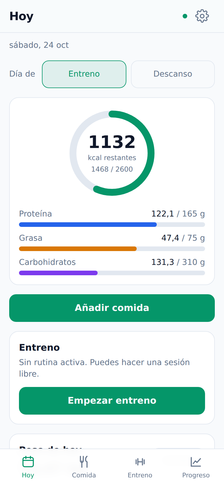
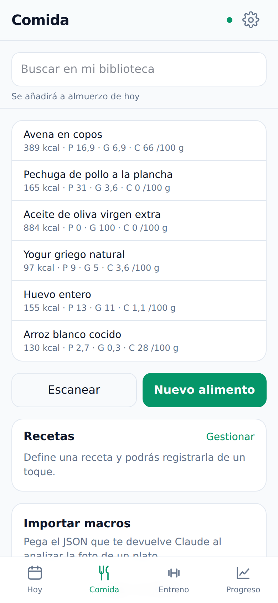
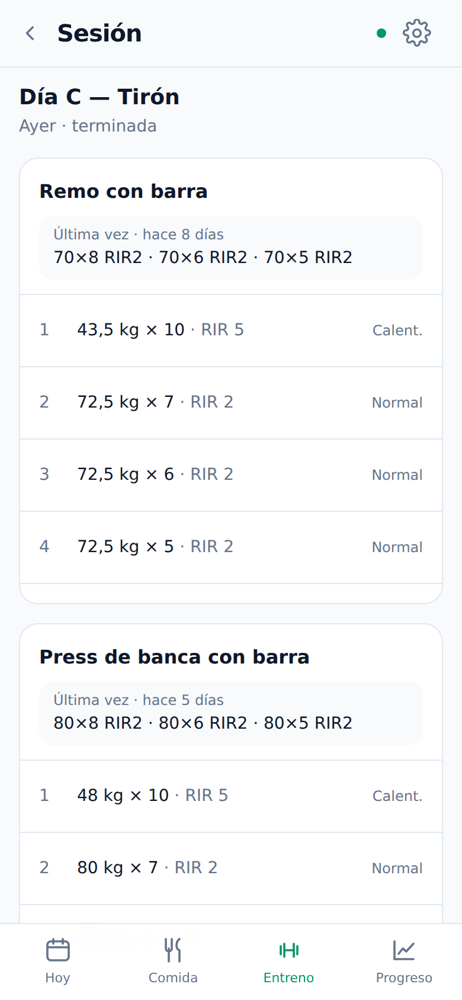
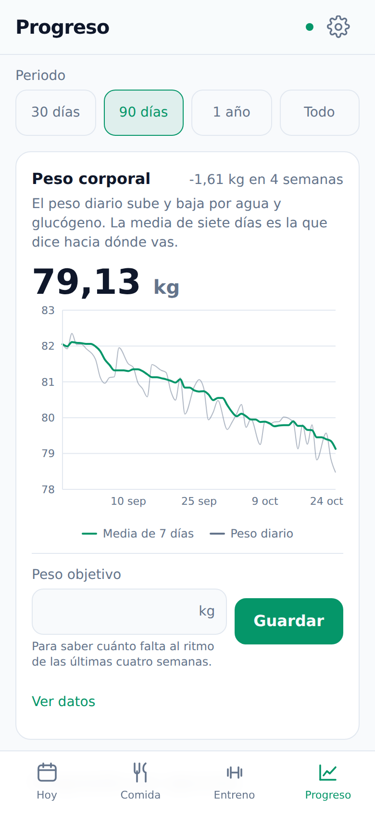
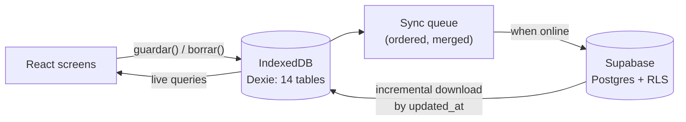

# Gym Tracker PWA

**An offline-first progressive web app to log meals, macros, workouts and body weight — built to be used with one hand, standing up, in a basement gym with no signal.**

Personal project · In daily use since September 2026 · React, TypeScript, IndexedDB, Supabase (Postgres + RLS)

<p align="center">
  
  
  
  
</p>

<p align="center"><sub>Screenshots taken with generated demo data on a local Supabase instance.</sub></p>

## The problem

Generic fitness apps are built for the couch, not the gym floor. They wait on the network to save a set, bury the last session's numbers behind several taps, and charge a subscription for charts. I wanted one tool for both training and nutrition that saves instantly with no signal, shows what I lifted last time right where I need it, and costs nothing to run.

## The solution

A PWA installed on the phone's home screen. Every write goes to a local database first, so the interface never waits for the network. A sync queue sends the changes to Postgres whenever there is a connection.

- **Today:** calories left and protein, fat and carbs against the goal for the day. Goals differ between training and rest days.
- **Food:** a personal food library, a barcode scanner backed by Open Food Facts, recipes that can be logged in one tap, and copying the previous day.
- **Training:** routines split by day, free sessions, warm-up vs. working sets, RIR, target rest time and favourites. Each exercise shows the sets from last time, and the next set is proposed from the working sets only.
- **Progress:** body weight with a 7-day moving average and the trend over the last four weeks, plus progression per exercise (max weight, volume, estimated 1RM), weekly averages and volume per muscle group. Warm-up sets don't count towards volume. Progress photos are kept in private storage.
- **Macro bridge, no AI API:** to estimate the macros of a dish from a photo, I ask Claude in its own app and share the JSON answer to a link. The app opens a preview of the meal, routine or food entries before importing them. Sharing to a link is the whole integration: there are no API keys and no running cost.
- **Full export** of all the data to JSON.

## How it works



The part that took the most care is the offline layer:

- **Client-generated UUIDs.** A session and its sets can be created offline and related to each other. Retries never duplicate rows.
- **Queue merging.** Correcting a set five times without signal leaves one pending operation, not five, and it keeps its place in the queue so foreign keys still arrive in order.
- **Strict ordering.** A failed transport error stops the queue instead of skipping ahead, and retries back off exponentially with jitter (2 s up to 5 min). Permanent Postgres errors are moved aside to a "failed" list that you can retry or discard, so one bad write can't block the rest.
- **Local cascades.** Deleting a session also deletes its sets locally and cancels their pending inserts. This mirrors what the server does, so no orphan rows appear later.
- **No lost edits.** The incremental download never overwrites changes that are still waiting to be uploaded. The sync indicator reads the real queue size, not `navigator.onLine`.

On the server side, every table has Row Level Security with `force row level security`, and `anon` has no grants. Exercises are archived instead of deleted, so history can't disappear, and `updated_at` triggers on every table give the sync a server clock.

The full reasoning behind each decision is in [`docs/estado.md`](docs/estado.md) (in Spanish).

## Tech stack

| Layer | Technologies |
|---|---|
| App | React 19, TypeScript, Vite, Tailwind CSS 4, React Router, Recharts |
| Offline | IndexedDB via Dexie, service worker (vite-plugin-pwa), installable on iOS |
| Backend | Supabase: Postgres, Row Level Security, Auth, Storage. There is no custom server |
| Other | ZXing (barcode scanning), Open Food Facts API |
| Quality | Vitest + Testing Library (243 tests), oxlint, GitHub Actions CI, scripts that check RLS and the schema against a real database |
| Hosting | Vercel (free tier). It is a single-user app behind a login, so there is no public demo |

## Running it locally

Requirements: Node 22 (pinned in `.nvmrc`) and Docker.

```bash
npm install
npx supabase start                 # local Postgres, Auth and Storage; applies the migrations
cp .env.example .env.local         # fill in with the URL and anon key printed by `supabase status`
npm run dev                        # http://localhost:5173
```

There is no sign-up screen, by design. Create a user in Supabase Studio (http://localhost:54323 → Authentication → Users) and seed the exercise catalog for it:

```sql
select public.sembrar_catalogo_ejercicios('you@example.com');
```

To explore the screens with data in them, run `node scripts/datos-demo.mjs`. It loads two months of fictional history and expects the user `yo@local.test` / `gimnasio123`, or set `EMAIL` and `PASSWORD`. Remove the data with `--borrar`.

## Checks

```bash
npm run comprobar   # types, lint with no warnings, 243 tests, build, and the production SQL is up to date
```

CI runs the same command on every push. The logic tests use `fake-indexeddb`, so they exercise Dexie for real, and the screen tests mount whole components in jsdom against that same database. What a test double can't prove is checked against a real Supabase:

```bash
node scripts/verificar-offline.mjs       # the contract with PostgREST
node scripts/verificar-aislamiento.mjs   # two accounts cannot see or write each other's rows
node scripts/verificar-produccion.mjs    # RLS and schema of the production project
```

## Context and my contribution

A personal project, built in about a week in September 2026. I've used it at the gym every day since I deployed it.

I defined the product and its constraints: zero cost, no custom backend, no AI API, offline first, one-handed use. I then built it end to end with AI-assisted development ("vibe coding" with Claude Code), reviewed every phase in the browser and on my phone, and deployed it. The commit history keeps the AI co-author trailers. The interface and the internal notes are in Spanish.
